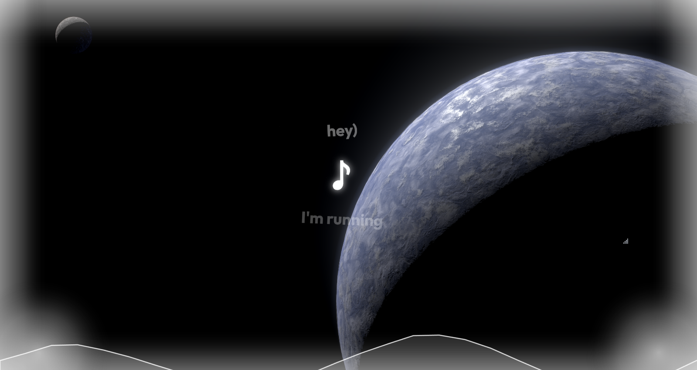

# Lyrics Widget 

A hardware-accelerated desktop lyrics widget and audio-reactive edge visualizer for Windows 10 and 11.

---

## Features

- **Universal Media Detection (Windows GSMTC)**
  - Integrates with Windows `GlobalSystemMediaTransportControlsSessionManager`.
  - Automatically captures now-playing media from Spotify, Apple Music, YouTube / YouTube Music (Chrome, Edge, Brave, Firefox), TIDAL, Foobar2000, and Windows Media Player without requiring API keys or sign-in.
  - Detects track title, artist, album art, playback state, and timeline position.

- **Desktop Edge Lighting & Audio Waves**
  - Transparent border overlay wrapping around the monitor perimeter.
  - 5 audio-reactive modes:
    - **Edge Waves**: Multi-segment audio waves along the screen borders reacting to system sound.
    - **Ambient Aura**: Ambient glow emanating inward from desktop edges.
    - **Full Waves + Aura**: Simultaneous desktop aura and border wave bars.
    - **Subtle Pulse**: Low-profile bass-reactive border glow.
    - **Off**: Standard focused widget mode.
  - Real-time WASAPI audio loopback FFT analysis for low-latency response.

- **12 Preset Styles**
  - **Amber**: Amber subtitle box with high-contrast pill styling.
  - **Supreme Red**: Bold streetwear aesthetic with bright scarlet box and italic text.
  - **Retro Pop**: Synthwave style with electric magenta and cyan accents.
  - **Glow Neon**: Glowing cyan and lime border styling with neon drop shadows.
  - **Cyber Blue**: Translucent midnight backing with icy blue accents.
  - **Pastel Violet**: Soft lilac gradient styling with clean typography.
  - **Minimal Mono**: Clean monochrome typography for distraction-free setups.
  - **Slanted Bold**: Forward italic skew for fast rap and trap tracks.
  - **Fisheye Bubble**: Barrel lens scale effect with rounded capsule frame.
  - **3D Isometric**: Slanted perspective angle with simulated extruded block drop shadow.
  - **Wavy Ribbon**: Serpentine tilted wave contours.
  - **Glitch Aberration**: Cyberpunk chromatic aberration offset with split neon borders.

- **5 Kinetic Animation Engines**
  - **Elastic Zoom Pop**: Snappy spring pop.
  - **3D Kinetic Flip**: Multi-axis tumbling roll with bounce settle.
  - **Jelly Morph**: Squash & stretch physics for bouncy transitions.
  - **Cyber Glitch**: Fast jitter, skew slices, and chromatic shifts.
  - **Silky Smooth Drift**: Quintic glide and floating inertia.

- **Lyrics Synchronization & Word Roller**
  - **Word-by-Word**: Single word progression.
  - **1-2 Word Chunks**: Rhythmic phrase chunks.
  - **Full Lines**: Classic karaoke presentation with responsive auto-scaling for long lines.

- **Dual Detection Engine: Automatic + Manual Search**
  - **Automatic Multi-Tier Search**:
    - Direct LRCLIB synchronized query with track duration validation.
    - Loose metadata fallback (strips featured artists, remaster tags, video labels).
    - Fuzzy keyword search on LRCLIB.
    - Plain text fallback from Lyrics.ovh with linear time-distribution algorithm.
  - **Manual Search**:
    - Search modal to manually look up any song title or artist.
    - Rescan button to instantly re-sync the current playing track.

- **Custom Color Picker & Themes**
  - Color picker palette (Yellow, Red, Cyan, Green, Purple, Pink, Orange, White).
  - Hex code input support with live preview.
  - Dynamic palette synchronization with album art.

- **Desktop Controls**
  - Always On Top pin toggle.
  - Lock Position toggle to disable dragging during games or full-screen work.
  - Card View vs 3-Line Vertical Roller View toggle.
  - Auto-hiding control toolbar on mouse leave.

---

## Tech Stack & Requirements

- **OS**: Windows 10 (1809+) or Windows 11
- **Framework**: .NET 9.0 (WPF / C# 13)
- **Windows Runtime APIs**: `Windows.Media.Control`, `Windows.Storage.Streams`
- **Audio Capture**: `NAudio.Wasapi` (WASAPI Loopback Capture)
- **Networking**: `System.Net.Http`, `System.Text.Json`

---

## Getting Started

### Prerequisites
Install the [.NET 9 SDK](https://dotnet.microsoft.com/download/dotnet/9.0) on Windows.

### Clone & Build
```powershell
git clone https://github.com/raikezdev/lyrics-widget.git
cd lyrics-widget
dotnet build "made by raikezdev.sln"
```

### Run
Double-click `run.bat` or execute:
```powershell
dotnet run --project LyricsWidget.csproj
```

### Publish Single-File Executable
To compile a single standalone `.exe`:
```powershell
dotnet publish LyricsWidget.csproj -c Release -r win-x64 --self-contained false -p:PublishSingleFile=true
```
The compiled executable will be located in:
`bin/Release/net9.0-windows10.0.19041.0/win-x64/publish/LyricsWidget.exe`

---

## Controls

| Control | Action |
|---|---|
| Preset | Cycle through the 12 typographic and FX presets |
| Roller Mode | Toggle between Single Words, 1-2 Chunks, and Full Lines |
| Animation | Cycle between Zoom Pop, 3D Flip, Jelly Morph, Cyber Glitch, and Smooth Drift |
| Edge Lighting | Cycle through the 5 desktop edge sound wave and aura modes |
| Color | Open the custom theme and color picker flyout |
| Search | Open manual lyrics search flyout |
| Rescan | Force instant re-scan and sync of the current playing track |
| Pin | Toggle Always On Top |
| Lock | Lock or unlock widget dragging position |
| View | Toggle between 3-Line roller and full scrolling card view |
| Close | Exit Lyrics Widget |

---

## Credits

- Made by **raikezdev**
- Lyrics provided by [LRCLIB](https://lrclib.net/) and [Lyrics.ovh](https://lyrics.ovh/).
